# Oportunidades — NectarCRM

Fontes: categoria **Módulos**, seção **Oportunidades** (16/16 artigos lidos integralmente, `https://ajuda.nectarcrm.com.br/hc/pt-br/sections/5466340034067-Oportunidades`). Ver `pipelines.md` para a configuração de Funil de Vendas (seção separada em Configurações).

## CONFIRMADO POR DOCUMENTAÇÃO

### Criação

- Dois caminhos de criação: "Ações Rápidas" (atalho global) ou botão "+" na tela de Oportunidades. O funil pré-selecionado é sempre o funil marcado como padrão nas configurações. Fonte: `5470183240083`.
- Campos organizados em abas por seção configurável, com bloco de preenchimento rápido para campos obrigatórios (mesmo padrão de UX de Contatos).
- **Produtos da oportunidade**: podem ou não estar vinculados a uma tabela de preços (permite alterar precificação de um produto temporariamente, ex. promoção, sem alterar o preço original). Tabelas de preço podem ser restritas a usuários/equipes e limitadas a uma por oportunidade (depende de parâmetros).
- **Regras de desconto/acréscimo em produtos** (fonte `5470183240083` e `34703447161363`):
  - Cada produto tem um limite de desconto próprio (valor fixo ou percentual) definido pelo administrador; cada usuário também tem um limite de desconto (sempre percentual) definido por permissão.
  - Existem duas configurações distintas: a **permissão** para dar desconto (binária, por produto) e o **limite** de desconto (numérico, por produto ou por usuário) — um produto precisa estar habilitado a receber desconto independentemente do limite do usuário.
  - Texto literal sobre o limite final aplicado: *"O limite final permitido será o maior valor entre o desconto permitido pelo produto e o limite do usuário. Esse será o desconto máximo que o sistema deixará o usuário aplicar ao produto."* (fonte: `34703447161363`). **CONFIRMADO por mais 2 artigos independentes** (`5476936353811` "Parâmetros de Produtos" e `5477033504147` "Parâmetros de Usuários", ambos em `configuracoes.md`): se o limite percentual do usuário é maior que o do produto, prevalece o do usuário — "a prioridade será os números do vendedor". A regra é contraintuitiva (esperar-se-ia o menor dos dois limites, não o maior) mas está confirmada de forma consistente em 3 artigos distintos, não é erro de redação isolado.
  - Desconto/acréscimo pode ser aplicado individualmente por produto ou globalmente (todos os produtos de uma vez), com dois modos de distribuição:
    - **Distribuir**: o percentual/valor total informado é dividido entre os produtos respeitando o limite individual de cada um (exemplo documentado: 10% global dividido por 3 produtos elegíveis = 3,33% cada, respeitando limites menores onde existirem).
    - **Replicar**: o mesmo percentual/valor é aplicado a todos os produtos, mas cada produto aplica seu próprio limite máximo caso o valor informado o exceda (produtos sem permissão de desconto ficam sem desconto).
  - Desconto pode ser monetário (R$) ou percentual (%).
- **Corresponsável de oportunidade** ("hack" documentado em `5470183240083`): habilitado via parâmetro do funil. Corresponsável pode visualizar, editar, dar feedback e fazer follow-up (tarefas/compromissos), mas **não pode alterar o responsável** da oportunidade. Parâmetro do funil também define se corresponsáveis de equipe diferente da do responsável podem aparecer como opção (relevante só em bases com restrição por equipe). Metas não são influenciadas por corresponsabilidade. Relatórios de corresponsabilidade disponíveis no BI, na tabela de Oportunidades.
- Administrador pode definir campos obrigatórios da oportunidade e se a oportunidade pode ser criada sem produtos vinculados (ambos configuráveis por funil).

### Pipeline / mudança de etapa

- Mudança de etapa manual: clicar na etapa desejada (na visão de detalhe) ou arrastar o card na visão Kanban. Bloqueada se houver tarefa obrigatória em aberto, a menos que a configuração "Pular etapa" esteja ativa (administradores não sofrem essa restrição). Fonte: `5470214819347`, `5466484015635`.
- Ao mudar de etapa, abre-se uma janela para registrar considerações sobre a etapa concluída antes de salvar.
- Cards do Kanban são personalizáveis (Configuração > Comercial > Funil de Vendas > Funil desejado > Gerenciar Card) e mostram ações rápidas (ligar, e-mail, tags) e indicadores visuais automáticos:
  - **Data de fechamento esperado** (prevista pelo responsável);
  - **Idade da oportunidade** (dias desde a criação);
  - **Dias de estagnação na etapa** (dias sem mudança de etapa);
  - **Dias sem interação** (dias sem tarefa/compromisso/anotação/proposta/mensagem registrada).
  Fonte: `5470214819347`.
- Configurações por funil citadas: permitir pular etapas, permitir voltar etapas, auto-mudança de etapa ao concluir determinada tarefa, entre outras (ver `pipelines.md`).

### Estados / finalização da oportunidade

- Status documentados (enum usado na importação, `5466645422739`): **Em Andamento, Ganha, Perdida, Descartada, Prorrogada**.
- Finalização pode ocorrer de duas formas: botões na tela de detalhe da oportunidade (Ganhar, Perder, Descartar, Prorrogar — fonte `5470214819347`) ou arrastando o card, no Kanban, para a opção de finalização correspondente (fonte `5466484015635`): *"As opções são: Ganhar, Perder, Descartar e Prorrogar."*
- Campo "Fechada em" é preenchido quando o status é Ganha ou Perdida (fonte: `5466645422739`).
- **Motivos de ganho/perda**: na importação, informados a partir de uma lista pré-cadastrada ("informe um dos motivos cadastrados de ganha/perda da oportunidade"). Configuração completa em "Motivos de Ganho e Perda" (ver `pipelines.md`).
- **Restrição central sobre exclusão**: texto literal (`9149196364819`): *"Uma oportunidade só é removida quando o seu contato é excluído."* Não existe exclusão direta/isolada de uma oportunidade — para "descartar" uma oportunidade individual sem excluir o contato, usa-se o status Descartada, que é um estado de negócio, não uma remoção física do registro.
- Ao excluir o contato (e, por consequência, suas oportunidades), os dados perdidos permanentemente mesmo após restauração: campos personalizados da oportunidade e dos produtos vinculados, tags, tarefas, compromissos, e-mails vinculados, anexos. Restauráveis: campos padrão, feedbacks, formulários preenchidos. Restaurar uma oportunidade restaura automaticamente o contato junto (se ainda não tiver sido restaurado). Fonte: `9149196364819`.

### Probabilidade / temperatura

- Enum histórico usado na importação (`5466645422739`): **Fria, Morna, Quente, Muito Quente**.
- Desde a introdução da **Saúde do negócio** (feature de IA, ver abaixo), a régua de temperatura tem duas variantes conforme o parâmetro "Saúde do negócio define a probabilidade" (Configuração > Parâmetros > Funil comercial, ligado por padrão):
  - **Parâmetro ligado**: Probabilidade = nota de saúde do negócio (recalculada automaticamente). Faixas: Quente (≥72), Morna (50–71), Fria (30–49), Risco alto (<30). O grupo "Probabilidade" fica oculto nos filtros de lista.
  - **Parâmetro desligado**: probabilidade volta a ser preenchida manualmente pelo vendedor; régua clássica: Muito Quente (≥75), Quente (50–74), Morna (25–49), Fria (<25).
  Fonte: `55476487662995`.
- Administrador pode "Restaurar probabilidades": reverte para o último valor preenchido manualmente por uma pessoa antes de 01/09/2026 (data fixa citada no artigo), com prévia antes de aplicar e guarda de cópia dos valores atuais. Só disponível com o parâmetro desligado.

### Saúde do negócio (feature de IA)

Fonte: `55476456152211` + `55476487662995`.

- Nota de **3 a 99** por oportunidade, calculada a partir de **intenções de feedback** marcadas (manualmente ou sugeridas por IA) nos feedbacks da oportunidade.
- Toda oportunidade começa com nota **50**. Cada intenção soma/subtrai seu peso (de -30 a +30, configurável por intenção). O efeito de uma intenção **decai com o tempo** (cai pela metade a cada 14 dias, regra geral citada). Se a oportunidade ficar mais de 5 dias sem feedback novo, a nota desce um pouco por dia. Recalculada diariamente de madrugada para oportunidades em aberto, e também ao marcar/remover/confirmar/rejeitar uma intenção ou ao terminar uma análise de IA.
- 12 intenções pré-cadastradas por padrão, divididas em "que empurram o negócio" (Budget sinalizado, Decisor identificado, Dor confirmada, Prova de valor aceita, Sinal de fechamento, Urgência declarada, Decisor engajado) e "que travam o negócio" (Concorrente identificado, Sem retorno do cliente, Decisão adiada, Objeção de preço, Escopo mudou). Categorias possíveis ao criar/editar: Necessidade, Autoridade, Budget, Timing, Competição, Engajamento, Neutro.
- IA lê feedbacks de **oportunidade** apenas (não analisa feedback de contato ou lead) e sugere intenções + gera "Resumo da IA"; sugestões aparecem com borda tracejada e podem ser confirmadas/rejeitadas; contam na nota mesmo antes de confirmadas. IA consome créditos do "Nectar AI" da conta; sem saldo, só param as sugestões/resumo, o resto funciona.
- Mudar o peso de uma intenção (edição manual ou "recalibração") não altera marcações já feitas, só vale para novas marcações — peso é gravado no momento da marcação.
- Função "Análise de fechamento": compara o peso configurado de cada intenção com o resultado real de oportunidades ganhas/perdidas (períodos de 30/90/180/365 dias), indicando quais pesos "confirmam", estão "sem evidência conclusiva" ou "contradizem" o peso atual; uma intenção só entra na proposta de recalibração com ao menos 10 oportunidades fechadas e resultado claro.
- Relatório "Adesão às intenções" (em Estatísticas > Relatórios) mostra por usuário: feedbacks no período, feedbacks marcados, taxa de adesão.

### Insights / Widget de Metas (painel do funil)

Fonte: `20346932352787`, `24100449792915`.

- **Oportunidades em risco**: widget que identifica oportunidades sem atividades, com atividades em atraso, estagnadas na etapa além do esperado (configurável por funil) ou atrasadas; mostra valor acumulado destas oportunidades.
- **Indicadores** com fórmulas documentadas:
  - Conversão = Quantidade de oportunidades ganhas no mês / Quantidade de oportunidades finalizadas no mês.
  - Ticket Médio = Soma de valores de oportunidades ganhas / Quantidade de oportunidades ganhas.
- **Top 5 Motivos de Ganho e Perda**: ranking dos motivos mais usados no funil atual com soma de valores associados.
- **Widget de Metas**: meta de arrecadamento por funil e/ou por usuário (recorrência única/mensal/total); forecast calculado a partir de oportunidades com data limite no mês atual cuja probabilidade seja "quente" ou "muito quente".

### Visão de funis (listagem)

Fonte: `47480803587731`. Tela de listagem de funis mostra: nome do funil, quantidade de oportunidades vinculadas, data da última atualização do funil (criação de oportunidade, movimentação entre etapas, ganho/perda, edição de campos que afetam valor), tipo de funil (ex.: com valor recorrente), indicação de funil padrão. Trocar de funil na visão não altera as oportunidades, só a exibição.

### Sidebar e edição

- Clique único abre pré-visualização em sidebar lateral; duplo clique (ou novo clique na sidebar já aberta) abre em página cheia. Pode ser desativado globalmente (preferência "Em página completa"). Fonte: `18918369619987`.
- Duplicação de oportunidade disponível (botão "Duplicar"). Fonte: `5470214819347`.
- WhatsApp: botão de atalho abre a conversa direto com o contato da oportunidade, desde que o telefone cadastrado no Nectar seja o mesmo do WhatsApp; não permite enviar anexo por esse atalho.
- Anexos da oportunidade também aparecem no Nectar Drive; removidos pelo Nectar Drive ficam 30 dias na lixeira sem sair da oportunidade; para remoção imediata da oportunidade é preciso excluir por lá mesmo.

### Importação/exportação

- Importação (`5466645422739`): requer que contatos e produtos já estejam cadastrados previamente (não cria contato/produto na mesma importação). Vínculo ao contato via ID, Código ou Nome (nome deve ser idêntico ao cadastrado). Vínculo ao funil via ID do funil + número da etapa (etapa inexistente cai na primeira etapa do funil). Campos de produto em aba separada da planilha ("Prods"), vinculados por "linha relacionada". Mesmas regras de arquivo (XLS, só 1ª planilha, ordem fixa de colunas, sem interrupção de colunas, limite de 10.000 registros, 10 MB).
- Atualização por importação (`16929780368531`): exportar com opção "Para atualização" → editar → reimportar; nunca alterar o campo ID (gera duplicação).
- Exportação (`5466677678995`): três tipos — Simples (resumo com produtos agrupados), Analítica (detalhada), Para atualização (template de importação). Link de download expira em 3 dias.
- Ação em massa (`26826070929939`): campos alteráveis em massa — Data limite, Responsável (inclui transferir tarefas/compromissos em aberto para o novo responsável), Funil de venda (+ etapa de destino), Tag (adicionar ou substituir todas), Origem.

## Diagrama de estados (CONFIRMADO POR DOCUMENTAÇÃO)

```mermaid
stateDiagram-v2
    [*] --> EmAndamento: Criação da oportunidade
    EmAndamento --> Ganha: botão/drag "Ganhar"
    EmAndamento --> Perdida: botão/drag "Perder" (motivo de perda obrigatório por cadastro)
    EmAndamento --> Descartada: botão/drag "Descartar"
    EmAndamento --> Prorrogada: botão/drag "Prorrogar"
    Prorrogada --> EmAndamento: reabertura (implícita; artigo não detalha transição de volta)
    Ganha --> [*]: Fechada em = data de conclusão
    Perdida --> [*]: Fechada em = data de conclusão
    Descartada --> [*]
    note right of EmAndamento
        Mudança de ETAPA (dentro do funil) é
        independente do STATUS acima: ocorre
        por drag-and-drop ou seleção manual,
        bloqueada se houver tarefa obrigatória
        pendente (salvo "Pular etapa" ativo).
    end note
```

Observação sobre o diagrama: a documentação lida não detalha explicitamente se "Prorrogada" retorna automaticamente a "Em Andamento" ou é um estado terminal à parte — nenhum artigo descreve essa transição de volta, por isso ela é marcada como implícita/não confirmada no diagrama. A exclusão física do registro **não é uma transição de estado do negócio**: só ocorre como efeito colateral da exclusão do contato (`9149196364819`).

### Campos padrão da Oportunidade (catálogo oficial documentado)

Fonte: `44213492154259` (categoria Configurações > Configurações de Campos). Agrupados por categoria: **Registro/atualização** (Atualiza em/por, Criado em/Finalizada em, Finalizado por, ID, Código); **Progresso/status** (Status — enum citado aqui como "aberta, em progresso, ganha, perdida", nota: usa rótulos diferentes dos vistos na importação "Em Andamento/Ganha/Perdida/Descartada/Prorrogada" — registrado como variação de redação entre artigos, não resolvido —, Data de estagnação na etapa, Dias sem interação na oportunidade, Prorrogada / Prorrogada para); **Pessoas/atividades** (Contato relacionado, Quantidade de atividades/compromissos/tarefas, Considerações/Observação); **Estratégico/comercial** (Origem, Valor, Valor mensal/MRR, Valor único, Venda na base).

## INFERIDO

- A transição Prorrogada → Em Andamento (reabertura) é presumida por analogia com o padrão de "conversa reaberta" visto no Nchat, mas não há artigo que descreva esse comportamento para oportunidades.

## NÃO VERIFICADO

- Fórmulas de cálculo de "Idade da oportunidade" e "Dias de estagnação" em termos de regra de corte/arredondamento exatos.
- Lista completa de parâmetros configuráveis por funil (tratados em `pipelines.md`, a partir da seção "Configuração de Funil de Vendas").
- Comportamento exato de "Descartada" vs. "Perdida" em termos de impacto nas métricas de conversão (o artigo de Insights define conversão só em termos de "ganhas / finalizadas", sem detalhar se Descartada conta como "finalizada").

## PROPOSTA DE IMPLEMENTAÇÃO

Nenhuma proposta de implementação própria registrada nesta rodada — documento é levantamento do NectarCRM; comparação e especificação ficam para fases posteriores.
