# Estados da conversa — diagrama

Estados confirmados por documentação: **Não iniciado**, **Em atendimento**, **Aguardando cliente**, **Concluída** (também chamada "Finalizada" em alguns artigos — mesmo conceito, nomenclatura inconsistente entre artigos da Dashboard/filtros, que usam "Finalizadas", e os 4 artigos dedicados a status, que usam "Concluída"). Fontes: 42121289961747, 42121881239315, 42122509976851, 42123024232851, 42116693619091, 42116615370131.

Transições confirmadas por documentação (trechos de evidência citados em `01-inventario/artigos.md`):

- **Não iniciado → Em atendimento**: quando um atendente assume manualmente, quando o bot encaminha automaticamente, ou quando um atendente envia um Template Meta para iniciar ativamente **[DOC]**.
- **Em atendimento → Aguardando cliente**: ação manual do atendente (menu ⋮ → "Aguardando cliente") **[DOC]**.
- **Aguardando cliente → Em atendimento**: automática, assim que o cliente envia nova mensagem **[DOC]** ("Ela retorna automaticamente à listagem assim que o cliente enviar uma nova mensagem").
- **Em atendimento → Concluída**: manual (botão "Finalizar" + motivo de encerramento obrigatório) ou automática por tempo de inatividade (parâmetro de fila, 1–60 dias) **[DOC]**.
- **Concluída → Em atendimento (reabertura)**: automática, quando qualquer uma das partes (cliente ou atendente) envia nova mensagem; se dentro do fluxo do chatbot, o bot é reativado e reinicia o atendimento **[DOC]** ("Se a conversa estiver concluída e o cliente enviar uma nova mensagem, o bot será reativado").
- **Em atendimento → Não iniciado**: não há evidência textual direta desta transição — permanece **[NV]**; a documentação só descreve "Não iniciado" como estado inicial atribuído pelo bot/fila, nunca como destino de uma transição a partir de "Em atendimento".

## Diagrama (Mermaid `stateDiagram-v2`)

Transições sem anotação são **CONFIRMADO POR DOCUMENTAÇÃO**. A única transição marcada `HIPÓTESE` é especulativa (não documentada) e está destacada como tal.

```mermaid
stateDiagram-v2
    [*] --> NaoIniciado: cliente escreve pela 1a vez / fila sem atendente / fora do horario

    NaoIniciado --> EmAtendimento: atendente assume (manual)\nou bot encaminha\nou atendente envia Template Meta

    EmAtendimento --> AguardandoCliente: atendente marca manualmente\n(menu de 3 pontos)

    AguardandoCliente --> EmAtendimento: cliente envia nova mensagem\n(automatico)

    EmAtendimento --> Concluida: atendente clica Finalizar\n+ seleciona motivo obrigatorio\nOU inatividade atinge limite da fila (1-60 dias)

    Concluida --> EmAtendimento: nova mensagem do cliente ou do atendente\n(reabertura automatica; bot reativado se aplicavel)

    AguardandoCliente --> Concluida: HIPOTESE nao documentada -- atendente finaliza\nmesmo aguardando cliente (nao confirmado no texto lido)
```

## Observação sobre a transição marcada HIPÓTESE

Nenhum artigo descreve explicitamente se é possível clicar "Finalizar" estando no estado "Aguardando cliente" sem antes voltar para "Em atendimento". É plausível pela interface (o botão Finalizar aparece "no canto superior direito da tela" da conversa, não condicionado a um status específico), mas isso é **inferência de interface, não confirmação textual** — por isso a transição está marcada como hipótese e não deve ser tratada como regra de negócio validada.
