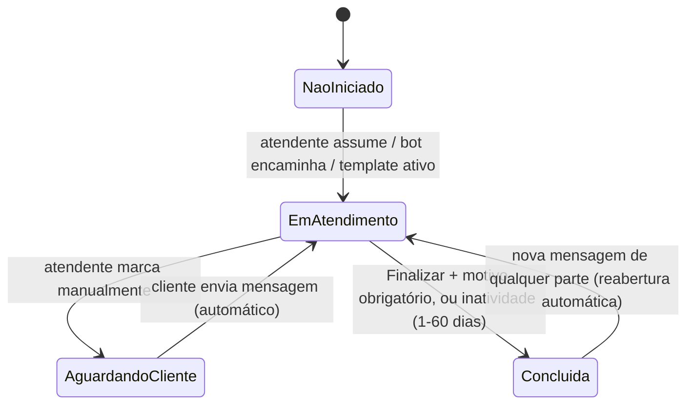
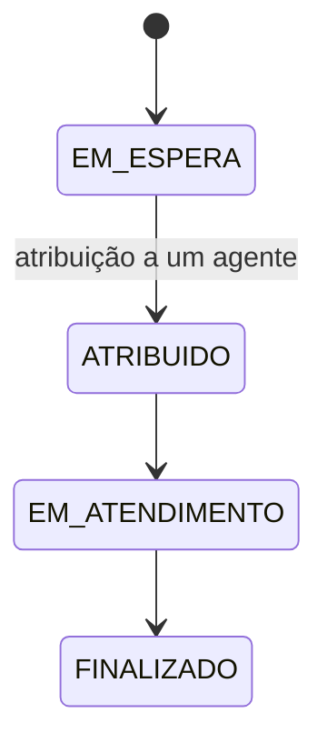
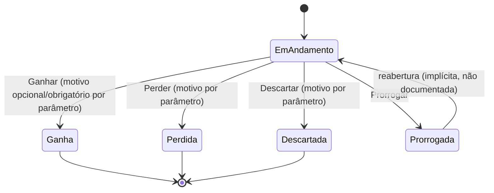
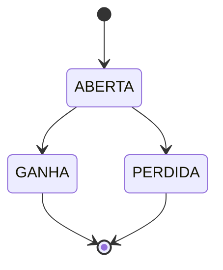
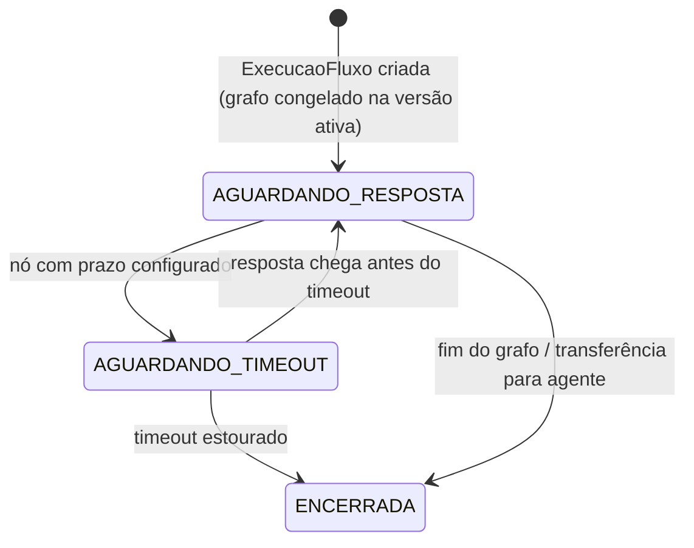

# Máquinas de estado

## Conversa de atendimento

### Nectar/Nchat — CONFIRMADO POR DOCUMENTAÇÃO (ver `03-nchat/estados-atendimento.md` para evidência completa)

### Nosso código — CONFIRMADO (enum lido por completo)

`ConversationStatus`: `EM_ESPERA, ATRIBUIDO, EM_ATENDIMENTO, FINALIZADO` (4 valores, confirmado em `apps/api/prisma/schema.prisma`).

**Achado concreto (gap real, não especulativo)**: o Nchat tem um estado que o nosso enum **não tem equivalente direto**: **"Aguardando cliente"** (a conversa foi respondida pelo atendente e está esperando o cliente responder, saindo da fila de pendências do atendente sem ser finalizada). Nosso enum só tem `EM_ATENDIMENTO` cobrindo esse intervalo inteiro — não há como, hoje, listar separadamente "conversas que eu respondi e aguardo o cliente" vs "conversas que o cliente respondeu e aguardam minha ação", que é exatamente o par de filas que todo atendente de WhatsApp precisa separar no dia a dia. Isso é uma lacuna real e concreta (ver `07-nosso-crm/lacunas.md`), não uma suposição.

Diferencial nosso que o Nchat não tem: o campo `arquivada` é **ortogonal** ao status (comentário do schema: *"uma conversa arquivada pode estar em qualquer status, inclusive FINALIZADO... Mensagem nova desarquiva automaticamente"*) — mais expressivo que o modelo do Nchat nesse eixo específico.

Recomendação concreta: avaliar adicionar um valor `AGUARDANDO_CLIENTE` ao enum (ou um campo booleano ortogonal, no mesmo espírito de `arquivada`), em vez de inferir esse estado a partir de "quem mandou a última mensagem" em tempo de leitura (mais caro e mais difícil de indexar/filtrar).

## Oportunidade comercial

### Nectar — CONFIRMADO POR DOCUMENTAÇÃO (ver `02-crm/oportunidades.md`)

Regra de exclusão física: *"Uma oportunidade só é removida quando o seu contato é excluído"* — não existe exclusão direta de oportunidade individual.

### Nosso código — CONFIRMADO (enum lido por completo)

`OportunidadeStatus`: **apenas 3 valores** — `ABERTA, GANHA, PERDIDA` (confirmado em `apps/api/prisma/schema.prisma`).

**Achado concreto (gap real)**: o Nectar documenta **5 estados** (Em Andamento, Ganha, Perdida, **Descartada**, **Prorrogada**), com regras de negócio específicas para cada um (Descartada não remove fisicamente o registro e fica fora do cálculo de conversão; Prorrogada tem data de reagendamento). Nosso enum **não distingue** "perdida de verdade" de "descartada" nem tem o conceito de "prorrogada" — qualquer oportunidade que não seja ganha hoje só pode ser `PERDIDA`, misturando semânticas que o Nectar separa por um motivo de negócio real (relatório de conversão do Nectar exclui Descartadas do denominador; se nós não distinguirmos, nosso cálculo de taxa de conversão ficará artificialmente mais baixo toda vez que alguém descartar uma oportunidade sem intenção de perda real). Esta é a lacuna de maior impacto direto em métricas encontrada em toda a comparação (ver `07-nosso-crm/lacunas.md`).

## Execução de fluxo (chatbot)

### Nectar — SEM máquina de estados documentada (apenas navegação por clique, sem estado persistente descrito)

### Nosso código — CONFIRMADO, já superior (enum lido por completo)

`EstadoExecucaoFluxo`: `AGUARDANDO_RESPOSTA, AGUARDANDO_TIMEOUT, ENCERRADA` (3 valores, confirmado). Isso já é **mais expressivo que qualquer coisa documentada do Nchat**, que não tem conceito de execução com timeout por nó — o único "tempo" documentado no Nchat é o limite de encerramento global da Primeira Mensagem (1min-24h, vale para a conversa inteira, não por nó).

## Proposta de concorrência para "assumir conversa" (já coberta em `03-nchat/atribuicao-transferencia.md`)

A proposta de `UPDATE ... WHERE status = X AND agenteId IS NULL` feita na Fase 3 continua válida e deve ser verificada contra a implementação real em `apps/api/src/modules/conversations` antes de ser considerada "a implementar" — pode já existir.
