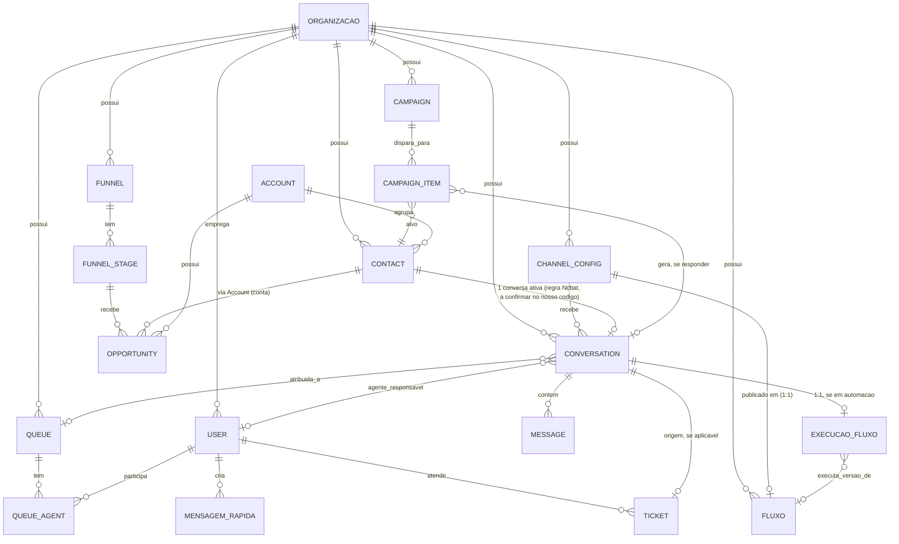

# Modelo relacional — núcleo de atendimento + CRM

ERD do **nosso schema real** (não um schema novo proposto — o projeto já tem um Prisma maduro). Escopo: só as entidades-núcleo relevantes a esta investigação (atendimento/Nchat-equivalente + CRM comercial). As demais 50+ models (LGPD, voz, tickets, credenciamento, etc.) existem mas ficam fora deste diagrama para legibilidade — ver `07-nosso-crm/modulos-existentes.md` para a lista completa.

## Notas de fidelidade ao schema real

- `ORGANIZACAO` = model `Organizacao`; todas as entidades têm `organizacaoId` como isolamento multi-tenant (confirmado em `Conversation`, `Message`, `Contact`, `Campaign`, `Fluxo`, `MensagemRapida`, `Ticket`, `Queue` — padrão consistente em todo o schema lido).
- `CONTACT ||--o| CONVERSATION` com cardinalidade "1 conversa ativa por contato" é a regra **documentada do Nchat** (`"O Nchat mantém uma única conversa ativa por contato"`), **ainda não confirmada como regra efetivamente imposta pelo nosso código** (não há `@@unique` visível no trecho de `Conversation` lido que force isso por `contatoId` — pode ser imposta na camada de aplicação, não no banco). Marcar como **PROPOSTA DE VERIFICAÇÃO**: conferir se `apps/api/src/modules/conversations` garante essa invariante, e se não, se deveríamos adicionar um índice único parcial (`WHERE status != 'FINALIZADO'`).
- `CHANNEL_CONFIG ||--o| FLUXO` é `@unique` confirmado no schema (`canalConfigId String? @unique` em `Fluxo`) — 1 fluxo publicado por canal, mesma regra do Nchat ("um número = um chatbot").
- Campos de equipe (`Equipe`/`Team` equivalente) e permissões não entraram no ERD por não terem sido lidos em profundidade nesta investigação — ver `09-relatorios/nao-verificado.md`.

## Chaves e índices observados (evidência direta do schema)

- `Message.idExterno` com `@unique` — idempotência de webhook (mensagem reentregue pela Meta não duplica).
- `ExecucaoFluxo.conversaId` com `@unique` — garante 1 execução de fluxo ativa por conversa.
- `Fluxo.canalConfigId` com `@unique` — garante 1 fluxo publicado por canal.
- `Queue` com `@@unique([organizacaoId, nome])` — nomes de fila únicos por organização, não globalmente (correto para multi-tenant).
- `CampaignItem` com `@@unique([campanhaId, contatoId])` — não disparar a mesma campanha duas vezes para o mesmo contato.
- `MensagemRapida` com `@@unique([organizacaoId, atalho])`.

Essas restrições já resolvem, no nível de banco, boa parte dos requisitos de integridade que a documentação do Nectar deixa como regra de negócio não garantida tecnicamente (ex.: o Nectar não documenta nenhuma proteção de banco contra reentrega de webhook; nós já temos).
